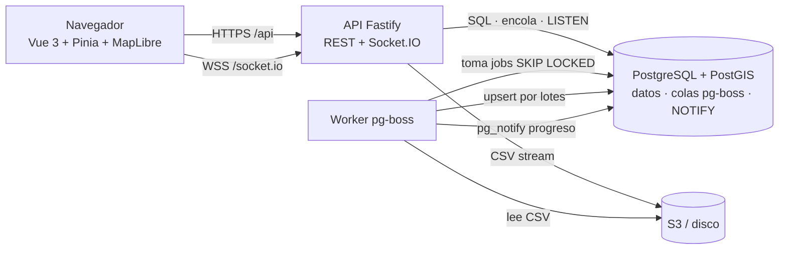
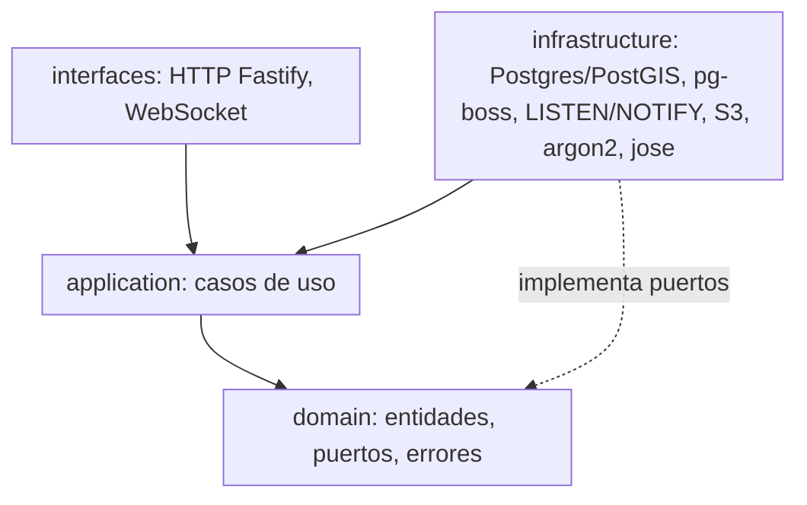
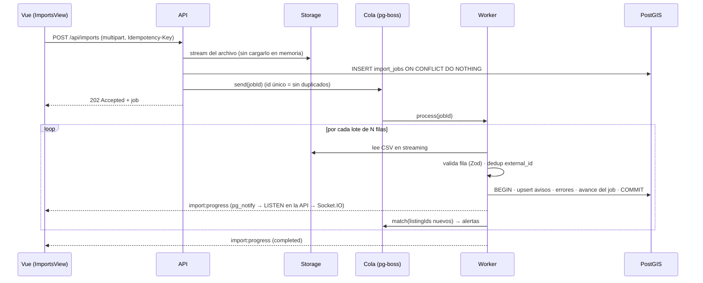
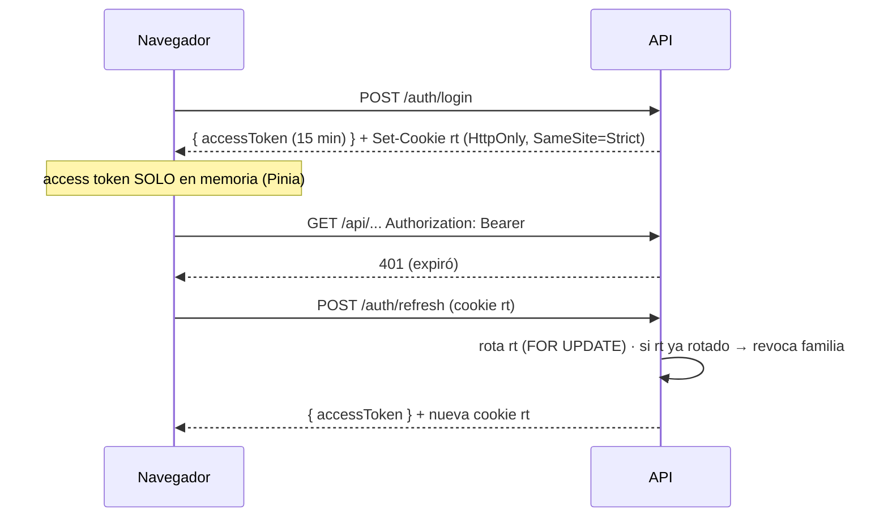

# Arquitectura

## Vista de despliegue

- **backend** y **frontend** son paquetes independientes (dependencias, scripts y build propios).
- **shared** contiene solo contratos: esquemas Zod, tipos de eventos y políticas de acceso puras.
- API y worker son la misma imagen con comandos distintos y escalan por separado.

## Capas del backend (Clean Architecture)

| Capa | Carpeta | Puede importar |
|---|---|---|
| Dominio | `backend/src/domain` | `@portal/shared` |
| Aplicación | `backend/src/application` | dominio |
| Infraestructura | `backend/src/infrastructure` | dominio, librerías |
| Interfaces | `backend/src/interfaces` | aplicación, dominio |
| Composición | `backend/src/container.ts` | todo (único punto de ensamblaje) |

La regla se hace cumplir **dos veces**: con ESLint (`no-restricted-imports` por carpeta) y con un test de arquitectura (`backend/tests/unit/architecture.test.ts`).

## Pipeline de carga masiva

## Autenticación de doble token

