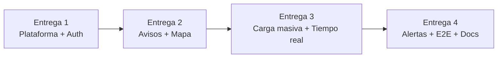

# Plan de trabajo y entregas del equipo

El proyecto se divide en **4 cortes verticales**: cada integrante es dueño de una funcionalidad completa (shared → backend → frontend → tests → docs). Así cada entrega es demostrable por sí sola y el historial de Git muestra el aporte de cada persona.

| # | Integrante | Funcionalidad | Criterios de la rúbrica que cubre |
|---|---|---|---|
| 1 | _Persona 1_ | **Plataforma, arquitectura y autenticación** | Arquitectura · Seguridad (doble token, RBAC/ABAC) · CI |
| 2 | _Persona 2_ | **Avisos, búsqueda espacial y mapa vectorial** | Frontend (Pinia normalizado, virtualización) · PostGIS · Concurrencia (bloqueo optimista) |
| 3 | _Persona 3_ | **Carga masiva en background y tiempo real** | Desafío técnico (pipeline, colas, WebSockets) · Transacciones ACID |
| 4 | _Persona 4_ | **Alertas por zona, notificaciones y cierre de calidad** | Lógica de negocio (alertas programadas) · Testing E2E · Documentación final |

> Reemplacen _Persona N_ por sus nombres.

## Orden de las entregas

Cada entrega se construye sobre la anterior y **compila y pasa sus tests por sí sola** (CI en verde en cada PR).



| Entrega | Qué se puede demostrar al terminar |
|---|---|
| 1 | Registro, login, sesión que sobrevive a recargar, rutas protegidas por rol. CI funcionando. |
| 2 | Mapa vectorial de Cali con los avisos, filtros, búsqueda dibujando un polígono, detalle y edición con control de concurrencia. |
| 3 | Subir un CSV masivo, ver el progreso en vivo, reporte de errores por fila, re-importar sin duplicar. |
| 4 | Crear zonas de alerta, recibir notificaciones al instante y el resumen diario; tests E2E; README final. |

## Archivos compartidos (de integración)

Algunos archivos los tocan varias personas porque conectan las piezas. Cada quien **solo agrega lo suyo** a ellos en su entrega:

- Backend: `src/container.ts` (registro de casos de uso), `src/interfaces/http/server.ts` (rutas), `src/main.ts`, `src/worker.ts`, `shared/src/index.ts`.
- Frontend: `src/router/index.ts`, `src/App.vue` (menú), `src/main.ts`, `src/views/SearchView.vue`.

## Flujo de trabajo con Git

1. Actualizar `main` y crear una rama propia:
   ```bash
   git checkout main
   git pull
   git checkout -b feature/<nombre-de-la-funcionalidad>
   ```
2. Trabajar en commits **pequeños y temáticos** con [Conventional Commits](https://www.conventionalcommits.org/es/): `feat(api): …`, `fix(web): …`, `test(db): …`, `docs: …`, `chore: …`.
3. Antes de subir: `npm run lint && npm run typecheck && npm test` (y `npm run test:integration` si tocaste SQL).
4. `git push -u origin feature/...` y abrir un **Pull Request** hacia `main` usando la plantilla.
5. **Otro integrante revisa** el PR (rotación: 1 revisa a 2, 2 a 3, 3 a 4, 4 a 1). Se mezcla solo con el CI en verde.
6. Cada integrante hace commit **desde su propia cuenta** (`git config user.name` / `user.email` con sus datos).

## Commits sugeridos por entrega

### Entrega 1: Plataforma, arquitectura y autenticación
1. `chore: configuración del monorepo (workspaces, TypeScript, ESLint, Vitest)`
2. `docs: arquitectura, requisitos, casos de uso y ADR 0001-0002`
3. `feat(db): modelo de datos inicial y migrador SQL`
4. `feat(shared): contratos de autenticación y políticas RBAC/ABAC`
5. `feat(auth): casos de uso de registro, login y refresh con doble token`
6. `feat(auth): adaptadores argon2, JWT y refresh tokens con detección de reuso`
7. `feat(api): servidor Fastify, manejo de errores y rutas de autenticación`
8. `feat(web): cliente HTTP, store de sesión, login/registro y guards de navegación`
9. `ci: pipeline de GitHub Actions y plantilla de PR`

### Entrega 2: Avisos, búsqueda espacial y mapa
1. `feat(shared): esquemas de avisos, búsqueda y polígonos GeoJSON`
2. `feat(listings): casos de uso de búsqueda con cursor y edición con bloqueo optimista`
3. `feat(db): repositorio PostGIS, teselas vectoriales MVT y monedas COP/USD`
4. `feat(api): rutas de avisos y teselas`
5. `feat(web): store de avisos normalizado con soporte offline`
6. `feat(web): mapa vectorial con dibujo de polígonos y listado virtualizado`
7. `feat(web): vistas de búsqueda y detalle con edición`
8. `docs: ADR 0003 PostGIS y teselas vectoriales`

### Entrega 3: Carga masiva y tiempo real
1. `feat(shared): esquemas de importación CSV y eventos en tiempo real`
2. `feat(imports): pipeline de ingesta por lotes, idempotente y reanudable`
3. `feat(db): repositorio de importaciones con upsert transaccional`
4. `feat(imports): lector CSV en streaming y almacenamiento local/S3`
5. `feat(jobs): colas en PostgreSQL con pg-boss y proceso worker`
6. `feat(realtime): eventos LISTEN/NOTIFY y Socket.IO autenticado`
7. `feat(api): rutas de importación con Idempotency-Key`
8. `feat(web): vista de carga masiva con progreso en vivo`
9. `chore: generador de catálogos CSV de prueba (Cali)`
10. `docs: ADR 0004 y 0006`

### Entrega 4: Alertas por zona y cierre
1. `feat(shared): esquemas de zonas y notificaciones`
2. `feat(alerts): casos de uso de zonas, cruce espacial y resumen diario`
3. `feat(db): repositorios de zonas y notificaciones sin duplicados`
4. `feat(jobs): alertas en el pipeline de ingesta y cron del resumen diario`
5. `feat(api): rutas de zonas y notificaciones`
6. `feat(web): vista de alertas, notificaciones en vivo y alerta desde la búsqueda`
7. `test(e2e): flujos principales con Playwright`
8. `docs: estrategia de pruebas, ADR 0005 y README final`
